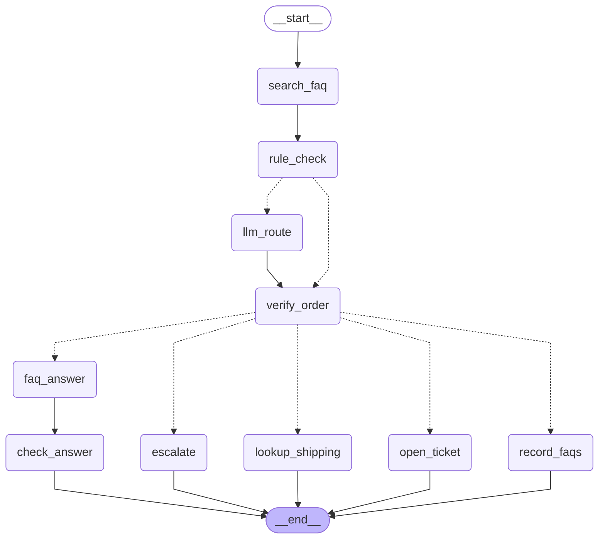

# 에이전트 처리 흐름 (LangGraph)

`backend/agents/graph.py`에서 자동으로 그린 그림입니다 (`python -m backend.agents.graph`). 점선은 상태에 따라 갈라지는 길(조건 분기)입니다.

답변 초안은 이 그래프 밖에서, 고객에게 응답한 뒤 씁니다 (`backend/services/drafts.py`).

| 노드 | 이름 | 하는 일 |
| --- | --- | --- |
| `search_faq` | FAQ 검색 | KURE + ChromaDB로 비슷한 FAQ 3개 (분류 유형과 같은 FAQ는 점수가 붙어 있을 때 조금 앞으로) |
| `rule_check` | 규칙 판단 | 확신도 0.8 미만·긴급도 높음·기타 유형이면 LLM 없이 담당자 연결 |
| `llm_route` | LLM 판단 | 처리 방식(자동 답변/답변 초안/담당자 연결)과 도구 선택 |
| `verify_order` | 주문 본인 확인 | 주문번호와 문의 이메일이 다르면 담당자 연결 |
| `faq_answer` | FAQ 답변 | 검색된 FAQ만 근거로 자동 답변 작성 |
| `check_answer` | 답변 검사 | 근거 부족·지급/승인 확정 표현이면 보내지 않고 초안으로 |
| `lookup_shipping` | 배송 조회 | 본인 주문의 배송 상태 |
| `open_ticket` | 티켓 접수 | 취소·교환·환불 티켓 |
| `escalate` | 상담원 이관 | 이관 티켓 |
| `record_faqs` | FAQ 기록 | 답변 초안 대상: 검색 결과만 기록 (초안은 고객 응답 뒤) |
